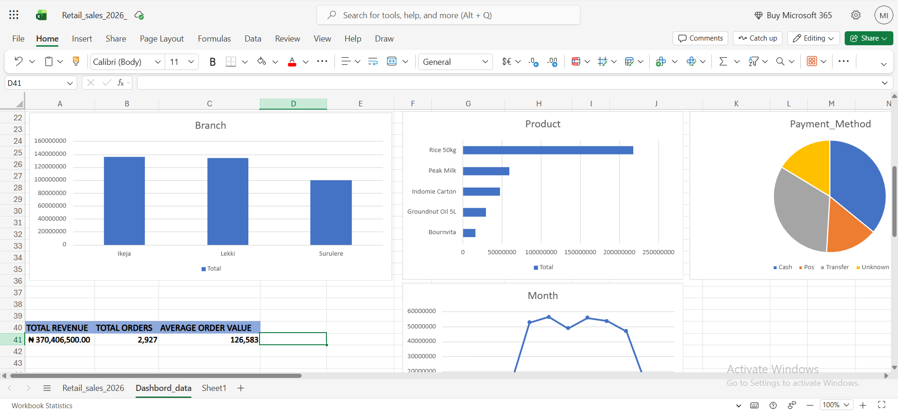

# Lagos Retail Chain — Sales Performance Analysis 2026

**Tools:** Python (Pandas) | Excel (PivotTables, PivotCharts, SUMIFS, XLOOKUP)  
**Data:** 2,927 cleaned transactions | 3 Branches | 5 Products | ₦370.4M Total Revenue  
**Files:** `data_creation_code.py` | `clean_sales.py` | `Retail_sales_2026.xlsx`



---

## 1. THE BUSINESS PROBLEM

A Lagos retail chain with 3 branches — Ikeja, Lekki, Surulere — was making decisions on messy sales data.

Management needed to know:
1. Which branch and product actually drives profit?
2. When is peak season, so we can stock correctly?
3. Are we losing money to bad data — unknown payments and unassigned sales?

The raw data had duplicate orders, inconsistent branch/product names, mixed date formats, and wrong prices. No dashboard could be trusted until it was cleaned.

---

## 2. HOW I DID IT

### Step 1: Generated Realistic Messy Data (Python)
Created `messy_retail_sales.csv` (3,109 rows) with intentional real-world errors to simulate a real company file — duplicates, `ikeja` vs `Ikeja`, `PEAK MILK` vs `Peak Milk`, dates in `27/06/2026`, `2026-06-27`, and `06-27-2026` formats.

### Step 2: Cleaned Data (Python + Pandas)
In `clean_sales.py`:
link to python for cleaning data in this repo.
[Clean_sales.py](clean_sales.py)

**Result:** 3,109 → 2,927 rows (182 duplicates removed). Products: 8 messy names → 5 clean. Payments: 6 variants → 4 clean.
___
Step 3: Analysed & Built Dashboard (Excel)
Opened cleaned_retail_sales.csv in Excel and built:
 •  5 PivotTables: Branch, Product, Month, Salesperson, Payment Method
 •  4 PivotCharts: Column (Branch), Bar (Product), Line (Month Trend), Pie (Payment)
 •  KPIs with =SUM(), =COUNTA(), =AVERAGE(), =SUMIFS()

## 3. WHAT I FOUND — BUSINESS IMPACT
```**Key Numbers**

KPI                  | VALUE
Total revenue        | N370,406,500
Total Order          | 2,927
Average Order Value  | N126,583
```
### Finding 1: Volume ≠ Revenue
Peak Milk sold the most units (743) but Rice 50kg made 3.6x more money.
 •  Rice 50kg: ₦217,855,000 (58.8% of all revenue) — 714 units
 •  Peak Milk: ₦59,466,000 — 743 units

**Recommendation:** Protect Rice stock at all costs. Don't judge performance by units sold alone.

### Finding 2: Revenue Is Highly Seasonal
 •  Jan-Apr: ₦7M - ₦11M per month (flat)
 •  May-Oct: ₦47M - ₦56M per month (peak)
 •  Nov-Dec: Crash to ₦11M / ₦6.6M

78% of revenue is concentrated in May-Oct.

**Recommendation:** Stock up heavily in April. Investigate Nov-Dec drop — stock-out, demand drop, or staff holiday?

### Finding 3: Surulere Is Underperforming
 •  Ikeja: ₦136,322,500 (36.8%)
 •  Lekki: ₦134,050,500 (36.2%)
 •  Surulere: ₦100,033,500 (27.0%)

**Recommendation:** Audit Surulere — location, staffing, or stock availability. ₦36M gap vs other branches.

### Finding 4: Data Quality = Money Risk
 •  Unknown Payment Method: ₦60,404,500 (16.3% of revenue) — audit risk
 •  Unassigned Salesperson: ₦44,292,000 (12% of revenue) — commission cannot be paid correctly
 •  POS is lowest payment method: ₦55,626,500 (15%) — check if POS machines are faulty

**Recommendation:** Make Payment Method and Salesperson mandatory fields at POS.
___
```HOW TO PRODUCE
# 1. Generate messy data
python data_creation_code.py

# 2. Clean it
python clean_sales.py

# 3. Open cleaned_retail_sales.csv in Excel
# 4. Adjust to columns and create insights + visuals.
```

**Limitations**
Data is synthetic for portfolio purposes. Salesperson performance for Ada/Tunde is inflated due to sampling in the generator. Findings on seasonality and product mix are directional.


## Author: MICHAEL I. IBEH | Data Specialist 